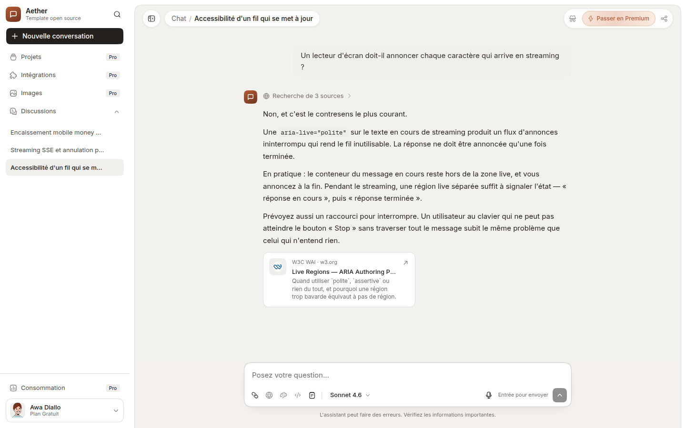
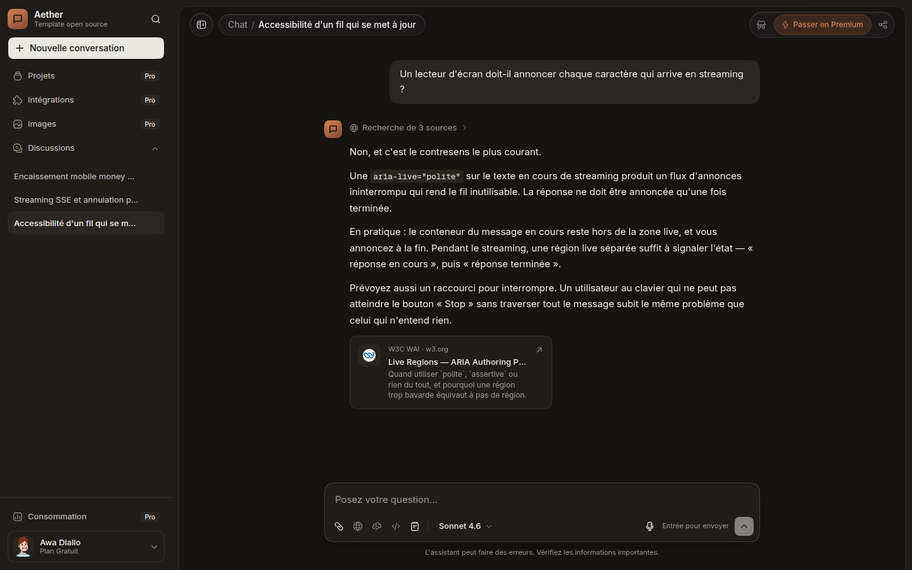
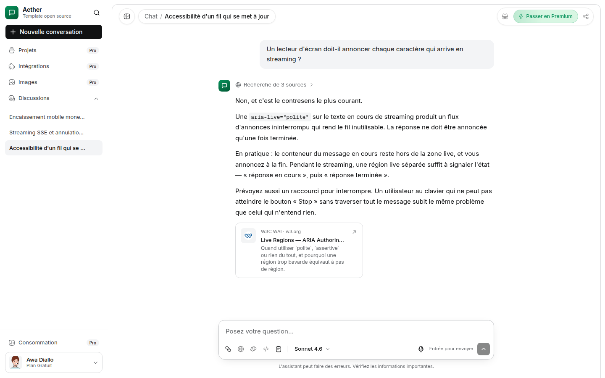
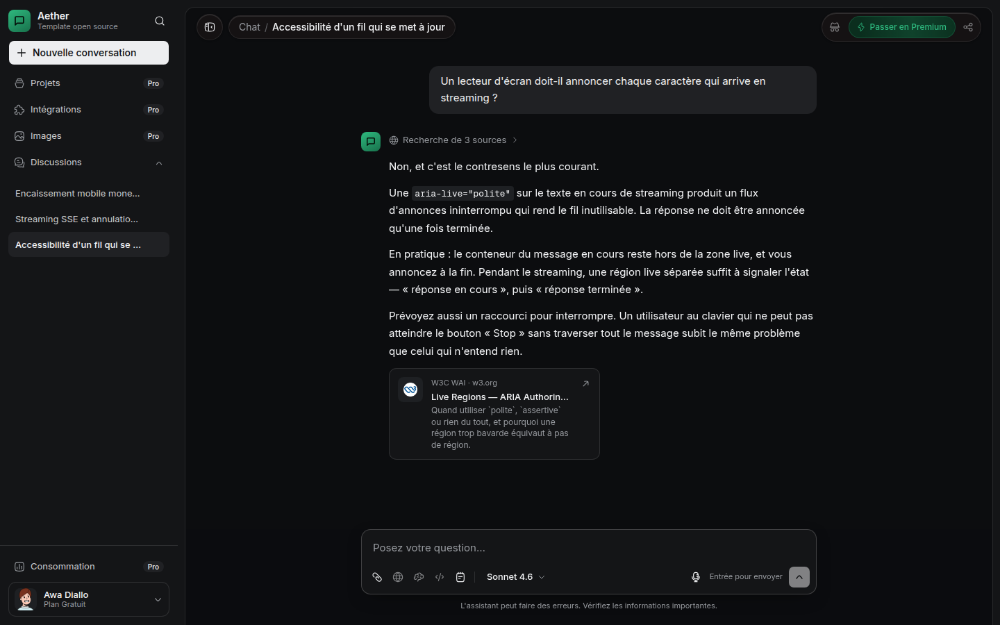
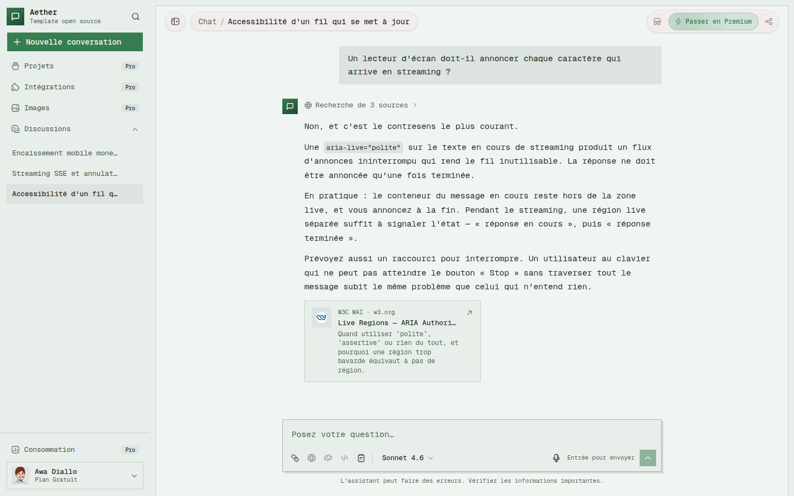
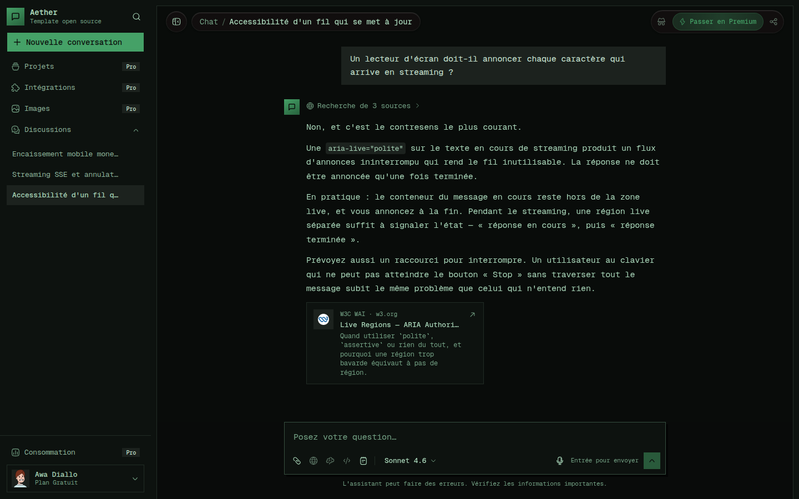
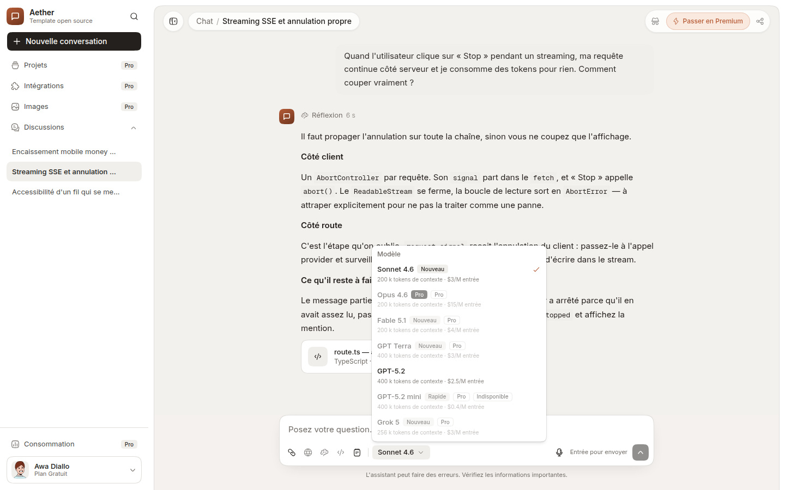
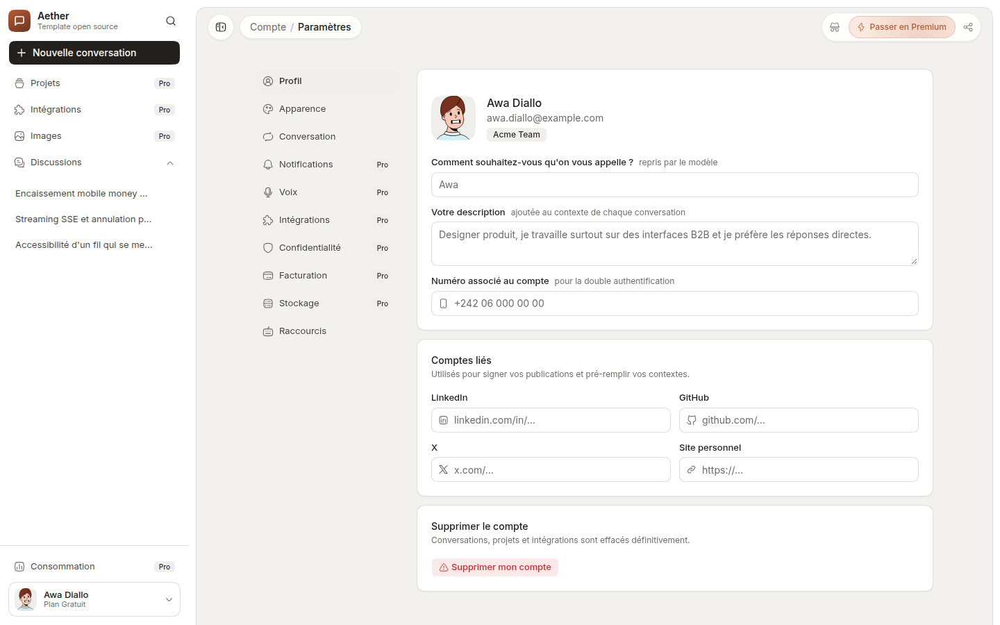

# Aether

**Template d'interface de chat IA, par UIForge**

Une interface de chat Next.js avec du vrai streaming, trois thèmes et une couche provider que vous pouvez brancher sur n'importe quel modèle. Elle tourne d'emblée sur un provider de démonstration : vous voyez le résultat avant d'ajouter une clé API.

[](LICENSE)



## Captures

Trois thèmes, chacun en mode clair et sombre. L'utilisateur choisit dans les paramètres, et son choix est gardé dans `localStorage`.

| Thème | Clair | Sombre |
| --- | --- | --- |
| Minimal |  |  |
| Contrast |  |  |
| Terminal |  |  |





## Démarrage rapide

Node.js 20.9 ou plus récent.

```bash
git clone https://github.com/UiForge-kit/uiforge-aether.git aether && cd aether
npm install
npm run dev
```

Ouvrez http://localhost:3000. Aucun fichier `.env` n'est nécessaire : sans clé API, l'application utilise un provider de démonstration. Ses réponses sont écrites d'avance, mais elles passent par la même route, le même protocole SSE et le même chemin d'annulation qu'un vrai modèle.

## Free et Pro

Ce dépôt est la version Free (MIT). Les modules Pro sont visibles dans l'interface mais verrouillés : chacun ouvre une carte « Disponible en Pro » à la place de la fonctionnalité. Le code Free ne contient qu'un point d'entrée par module, sans implémentation cachée.

| Module | Free | Pro |
| --- | :---: | :---: |
| Chat en streaming, historique, markdown, blocs de code | Oui | Oui |
| Canvas (documents longs à côté du fil) | Oui | Oui |
| Recherche de conversation, thèmes, paramètres (profil, apparence, conversation, raccourcis) | Oui | Oui |
| Projets | Verrouillé | Oui |
| Intégrations | Verrouillé | Oui |
| Images | Verrouillé | Oui |
| Voix | Verrouillé | Oui |
| Consommation | Verrouillé | Oui |
| Partage | Verrouillé | Oui |
| Conversation éphémère | Verrouillé | Oui |
| Réglages notifications, confidentialité, facturation et stockage | Verrouillé | Oui |

Le registre se trouve dans `config/modules.ts`. La navigation, les onglets de paramètres, les raccourcis et le sitemap en dépendent.

Les limites Free sont dans `config/limits.ts` :

| Limite | Valeur Free |
| --- | --- |
| Pièces jointes par message | 3 |
| Messages envoyés au modèle comme contexte | 10 (le client garde les 10 derniers, le serveur refuse au-delà) |
| Conversations gardées sur l'appareil | 30 (les plus anciennes non épinglées sont supprimées) |
| Modèles sélectionnables | `claude-sonnet-4-6`, `gpt-5.2` |
| Outils de saisie | `attachments`, `canvas` |

`POST /api/chat` applique les limites de modèle, d'outils, de contexte et de pièces jointes côté serveur : masquer un bouton dans l'interface n'est pas la seule protection.

Le lien d'achat affiché sur les cartes verrouillées se règle avec `NEXT_PUBLIC_UPGRADE_URL`. Laissez-le vide : la carte reste affichée, sans lien.

## Fonctionnalités

- **Chat en streaming** : fil de messages, markdown avec GFM, étapes de raisonnement repliables, aperçus de liens, pièces jointes, bouton d'arrêt qui conserve le message partiel.
- **Zone de saisie** : sélecteur de modèle, pièces jointes (glisser-déposer et coller inclus) et outils activables. Un outil que le modèle courant ne sait pas exécuter est désactivé automatiquement.
- **Blocs de code colorés** avec `prism-react-renderer`, partagés par le rendu markdown et le canvas. Les couleurs viennent de variables CSS : la coloration suit le thème actif.
- **Canvas** : un document long (code ou markdown) s'ouvre dans sa propre fenêtre, avec onglets, copie et téléchargement au bon nom de fichier.
- **Avis sur les réponses** : like et dislike à côté de la copie, du partage et de la relance. Les votes sont stockés à part du fil ; `store/feedback-store.ts` est l'endroit où brancher une vraie collecte de retours.
- **Recherche de conversation** en fenêtre modale (`⌘F`), avec aperçu, date et groupe pour chaque résultat.
- **Trois thèmes**, chacun en clair et sombre : `minimal`, `contrast`, `terminal`.
- **Barre du haut en verre** : des bulles translucides au-dessus du contenu avec `backdrop-filter` (`.glass-pill` dans `app/globals.css`), et un fond opaque là où le flou n'est pas géré.
- **Paramètres** : profil (surnom, description, avatars générés), apparence et police, conversation, raccourcis clavier.
- **Sélecteur de langue** : huit locales. Le choix est mémorisé mais rien n'est traduit, car le template n'a pas de couche i18n. Les identifiants de `config/languages.ts` suivent la BCP 47 pour faciliter le branchement de la vôtre.
- **Raccourcis clavier** : nouvelle conversation, arrêt de la génération, recherche, paramètres, barre latérale, bascule clair / sombre. La liste est dans `config/shortcuts.ts`, et `⌘` devient `Ctrl` hors macOS.
- **Persistance locale** : conversations et préférences survivent au rechargement, sans backend. Une interface `ChatStorage` permet de remplacer `localStorage`.
- **Responsive** : la barre latérale devient un tiroir sous 768 px.
- **Bases SEO** : routes `robots.txt` et `sitemap.xml`, URL canonique et métadonnées Open Graph. L'indexation est désactivée par défaut.

## Stack technique

| | |
| --- | --- |
| Framework | Next.js 16.3 (App Router) |
| UI | React 19.2 |
| Langage | TypeScript 5 (strict) |
| Styles | Tailwind CSS 4 |
| Composants | primitives shadcn/ui sur Base UI (`@base-ui/react`) |
| Icônes | Hugeicons (série gratuite) |
| Animations | Motion 13 |
| État | Zustand 5 |
| Markdown | react-markdown 10 + remark-gfm |
| Coloration du code | prism-react-renderer 2 |
| Avatars | DiceBear 9, générés localement |
| Graphiques | Chart.js 4 + react-chartjs-2 (installés, non utilisés par le code Free) |
| Node.js | 20.9 ou plus |

## Structure du projet

```
app/
├─ (app)/          routes : chat, paramètres, une route fine par module
└─ api/            chat (SSE), conversations
components/
├─ chat/           fil, messages, markdown, raisonnement, saisie
├─ canvas/         carte dans le fil et fenêtre dédiée
├─ code/           bloc de code coloré
├─ layout/         coquille, tiroir mobile
├─ pro/            cartes « Disponible en Pro »
├─ search/         recherche de conversation
├─ settings/       coquille des paramètres et sections
├─ sidebar/        historique groupé, navigation, compte
├─ topbar/         bulles en verre : sélecteur de modèle, lien d'achat
└─ ui/             primitives shadcn (à ne pas modifier, jouer sur les tokens)
config/            site, modèles, thèmes, polices, limites, limites API,
                   registre des modules, outils, raccourcis, langues
modules/           un dossier par module Pro, chacun un point d'entrée verrouillé
lib/
├─ ai/             registre des providers, encodage SSE, providers/
├─ api/            garde, rate limiter, lecture du corps, validation, tests
├─ storage/        interface ChatStorage et adaptateur localStorage
└─ mock/           données de démonstration et réponses simulées
store/             stores Zustand
types/             types partagés (types/ai.ts porte le protocole de flux)
docs/screenshots/  images utilisées par ce README
```

## Personnaliser

### Marque et nom

Modifiez `config/site.ts` : `name`, `shortName`, `tagline`, `description` et `repository`. Le lien d'achat vient de `NEXT_PUBLIC_UPGRADE_URL`, pas de ce fichier. `SITE_URL` lit `NEXT_PUBLIC_SITE_URL` et alimente l'URL canonique, Open Graph et le sitemap. `STORAGE_NAMESPACE` préfixe les clés écrites dans `localStorage` : changez-le pour ne pas partager de clés avec une autre instance d'Aether sur la même origine.

Les textes de l'interface sont en français. Modifiez-les directement : il n'y a pas de couche de traduction.

### Thèmes

Un thème ne redéfinit que des valeurs, jamais des noms : en ajouter un ne touche aucun composant.

1. Dans `app/globals.css`, copiez un bloc `[data-theme="..."]` et sa variante `.dark`, puis changez les valeurs. Les variables `--code-*` en font partie, la coloration suit donc.
2. Déclarez le thème dans `config/themes.ts` pour qu'il apparaisse dans le sélecteur.
3. Ajoutez sa palette de graphiques dans `config/chart-theme.ts`.
4. Étendez le type `ThemeId` dans `types/theme.ts`.

Un composant nomme un rôle (`--brand`), jamais une couleur brute. Le thème par défaut est `DEFAULT_THEME_ID` dans `config/themes.ts`.

### Avatars

`lib/avatars.ts` génère les avatars du profil en local avec DiceBear (trois styles : Adventurer, Fun Emoji, Micah). Aucune requête réseau. Si vous retirez un style, mettez aussi à jour la section d'attribution de `NOTICE`.

### Polices

`app/layout.tsx` charge Inter, Space Grotesk, Lora et Geist Mono via `next/font/google`. Les options du sélecteur sont déclarées dans `config/fonts.ts`. Pour ajouter une police, chargez-la dans le layout avec une variable CSS, puis ajoutez une entrée à `FONT_OPTIONS`.

### Modèles

`config/models.ts` liste les modèles du sélecteur, avec leurs vrais identifiants de provider, leur fenêtre de contexte et leurs capacités. `allowedModelIds` dans `config/limits.ts` décide lesquels le serveur accepte. Un modèle hors de cette liste reçoit un 403 de `/api/chat`, quel que soit le provider.

## Brancher un vrai modèle

Choisissez le provider dans `.env.local` :

```bash
AI_PROVIDER=anthropic
ANTHROPIC_API_KEY=votre-cle
```

Pour OpenAI : `AI_PROVIDER=openai` et `OPENAI_API_KEY`. Sans `AI_PROVIDER`, une clé Anthropic sélectionne Anthropic, sinon une clé OpenAI sélectionne OpenAI, sinon le mock tourne. Redémarrez le serveur après modification du fichier. Les clés ne sont lues que côté serveur.

Les deux adaptateurs utilisent `fetch`, sans SDK de provider.

### Le protocole SSE

`POST /api/chat` reçoit `{ messages, modelId, tools }` et répond en `text/event-stream`. Chaque trame est `data: <json>` suivie d'une ligne vide, et le JSON est l'un des six événements (`types/ai.ts`) :

```ts
type StreamEvent =
  | { type: "start"; messageId: string; modelId: string }
  | { type: "reasoning"; step: ReasoningStep }
  | { type: "delta"; text: string }
  | { type: "usage"; usage: TokenUsage }
  | { type: "done"; finishReason: FinishReason }
  | { type: "error"; code: string; message: string };
```

L'encodage et le décodage vivent tous deux dans `lib/ai/stream.ts`. L'interface ne connaît que ces événements : changer de provider ne touche aucun composant.

### Annulation

Le bouton Stop annule la requête. La route transmet `request.signal` au provider, et votre provider doit le passer au `fetch` amont. Sinon l'écran cesse de se mettre à jour mais l'appel amont continue, et vous continuez à le payer.

### Ajouter un provider

1. Créez `lib/ai/providers/<nom>.ts` qui exporte un `AIClient` : un générateur `streamChat(request)` qui produit des `StreamEvent`. `upstream-sse.ts` contient des helpers pour lire un flux SSE amont.
2. Ajoutez l'id à `ProviderId` dans `types/model.ts` et enregistrez le client dans `REGISTRY` de `lib/ai/client.ts`.
3. Lisez sa clé dans `process.env` côté serveur et documentez-la dans `.env.example`.
4. Sélectionnez-le avec `AI_PROVIDER=<nom>`, ajoutez ses modèles à `config/models.ts` et, si besoin, à `allowedModelIds` dans `config/limits.ts`.

Ne modifiez pas le protocole SSE en chemin : le client le décode.

## Protéger l'API

À lire avant la production. Telle que livrée, `/api/chat` est ouverte et peut consommer vos crédits d'API.

- **Authentification.** `authorize(request)` dans `lib/api/guard.ts` renvoie `null` par défaut, ce qui autorise tout le monde. Implémentez-y votre contrôle de session ou de clé d'API et renvoyez une `Response` 401 ou 403 pour refuser. Chaque route de `app/api/` passe par `guardRequest`.
- **Taille et forme des requêtes.** `config/api.ts` plafonne le corps à 256 Ko, 100 messages par requête, 32 000 caractères par message, 10 pièces jointes par message et 16 outils. Le payload est validé avant d'atteindre un provider.
- **Rate limit.** 20 requêtes par IP et par 60 secondes sur `/api/chat` (`API_RATE_LIMIT_MAX`, `API_RATE_LIMIT_WINDOW_SECONDS`), 120 par fenêtre sur `/api/conversations`. Les compteurs sont en mémoire et propres à chaque instance : ils ne servent à rien derrière plusieurs réplicas ou en serverless. Remplacez-les par un store partagé (Redis, KV) avant de vous y fier.
- **IP du client.** Le limiteur s'appuie sur `x-forwarded-for`, puis `x-real-ip`. La première valeur de `x-forwarded-for` peut être falsifiée si votre proxy n'écrase pas l'en-tête. Vérifiez comment votre hébergeur le renseigne.
- **Limites d'offre.** Modèles, outils, taille du contexte et pièces jointes sont vérifiés côté serveur dans `lib/api/entitlements.ts`.
- **Secrets.** Les clés restent dans l'environnement serveur. Ne les préfixez jamais par `NEXT_PUBLIC_`.

## Variables d'environnement

Copiez `.env.example` vers `.env.local`.

| Variable | Défaut | Description |
| --- | --- | --- |
| `AI_PROVIDER` | `mock` | Provider actif : `mock`, `anthropic` ou `openai`. Absent : la présence d'une clé sélectionne son provider. |
| `ANTHROPIC_API_KEY` | vide | Clé d'API Anthropic. Côté serveur uniquement. |
| `OPENAI_API_KEY` | vide | Clé d'API OpenAI. Côté serveur uniquement. |
| `NEXT_PUBLIC_SITE_URL` | `http://localhost:3000` | URL publique du déploiement, pour le canonical, Open Graph et le sitemap. |
| `NEXT_PUBLIC_ALLOW_INDEXING` | `false` | `true` pour laisser les moteurs de recherche indexer le site. |
| `API_RATE_LIMIT_MAX` | `20` | Requêtes autorisées par IP et par fenêtre sur `POST /api/chat`. |
| `API_RATE_LIMIT_WINDOW_SECONDS` | `60` | Durée de la fenêtre du rate limit, en secondes. |
| `NEXT_PUBLIC_UPGRADE_URL` | vide | Page d'achat liée depuis les modules verrouillés. Vide : pas de lien. |

## Scripts

| Commande | Rôle |
| --- | --- |
| `npm run dev` | Serveur de développement |
| `npm run build` | Build de production |
| `npm start` | Sert le build de production |
| `npm run lint` | ESLint |
| `npm run typecheck` | `next typegen` puis `tsc --noEmit` |
| `npm test` | Lanceur de tests Node sur `lib/**/*.test.ts` |

## Déployer

Aether est une application Next.js standard : tout hébergeur compatible Next.js convient. Sur Vercel :

1. Poussez le dépôt chez votre fournisseur Git et importez-le comme nouveau projet. Le preset Next.js ne demande aucun réglage.
2. Ajoutez les variables d'environnement du tableau ci-dessus dans les paramètres du projet. Renseignez au moins `NEXT_PUBLIC_SITE_URL`, et la clé de votre provider pour un vrai modèle.
3. Déployez.

La route de chat définit `maxDuration = 300` ; vérifiez la durée de fonction autorisée par votre offre. Lisez d'abord « Protéger l'API » : le rate limiter en mémoire ne couvre pas plusieurs instances serverless, et `authorize()` reste ouverte tant que vous ne l'avez pas implémentée.

## FAQ

**Ça marche sans clé API ?**
Oui. Le provider mock diffuse des réponses écrites d'avance par la vraie route et le vrai protocole. Seul le contenu est simulé.

**Pourquoi choisir Opus ou Grok renvoie une erreur ?**
Le sélecteur liste tous les modèles de `config/models.ts`, mais le `allowedModelIds` Free n'accepte que `claude-sonnet-4-6` et `gpt-5.2`. Le serveur refuse les autres avec un 403. Modifiez `config/limits.ts` pour choisir un autre ensemble.

**Où sont stockées les données ?**
Conversations, préférences et avis sont dans le `localStorage` du navigateur. Il n'y a pas de base de données. `GET /api/conversations` ne renvoie que des données d'exemple. Pour persister côté serveur, implémentez l'interface `ChatStorage` de `lib/storage/adapter.ts` et changez la ligne dans `lib/storage/index.ts`.

**L'interface est-elle traduite ?**
Non. L'UI est en français et le sélecteur de langue ne fait que mémoriser un choix. Voir la section Fonctionnalités.

**Puis-je l'utiliser dans un projet commercial ?**
Oui, le code est MIT. Gardez la licence et les mentions tierces (voir Licence).

**Comment débloquer les modules Pro ?**
Ils ne font pas partie de ce dépôt. Les cartes verrouillées pointent vers `NEXT_PUBLIC_UPGRADE_URL`.

## Licence

MIT, voir [LICENSE](LICENSE). Les contenus tiers sont listés dans [NOTICE](NOTICE). La galerie d'avatars utilise des styles DiceBear dont les illustrations sont sous licence CC BY 4.0, ce qui impose une attribution : conservez la section DiceBear de `NOTICE` (ou créditez les auteurs dans votre produit) tant que vous livrez ces avatars.

## Support

Un bug ou une question ? Ouvrez une issue sur le dépôt. Voir [CONTRIBUTING.md](CONTRIBUTING.md) pour proposer une modification.
