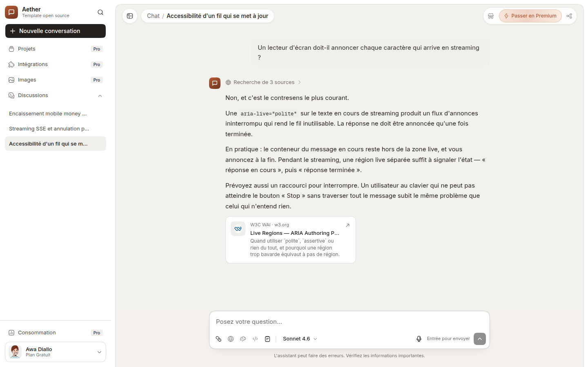
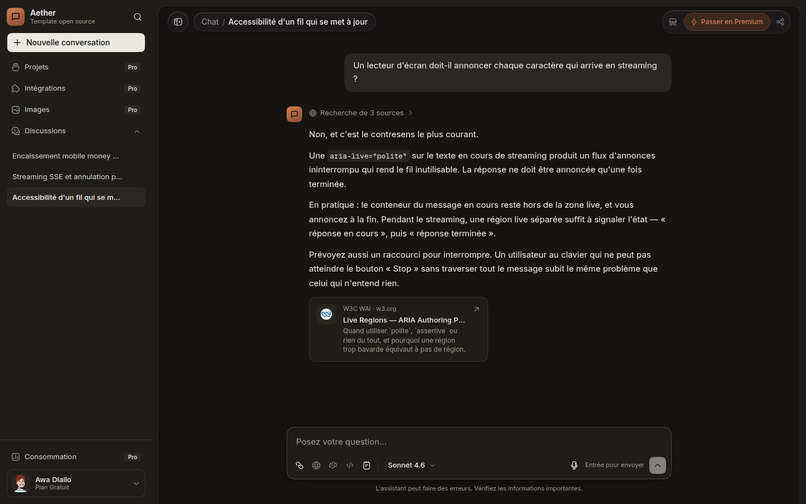
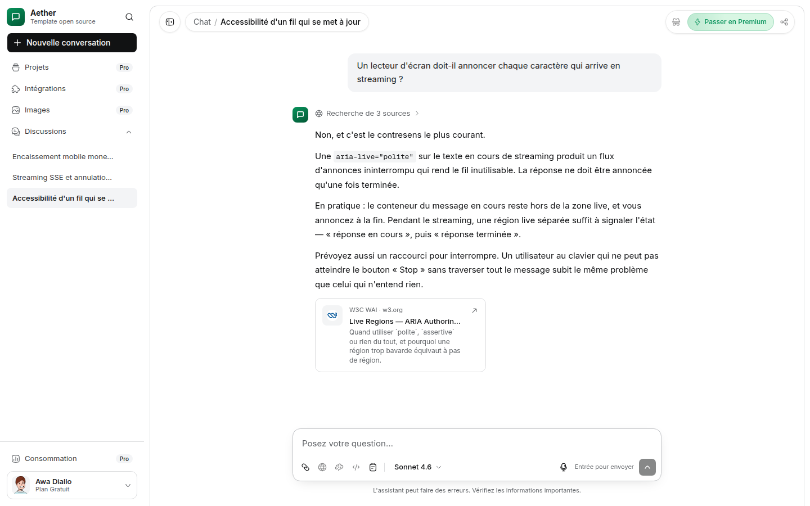
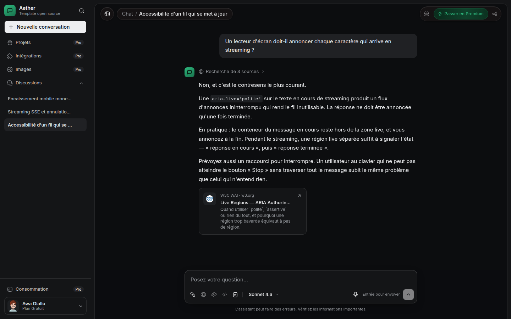
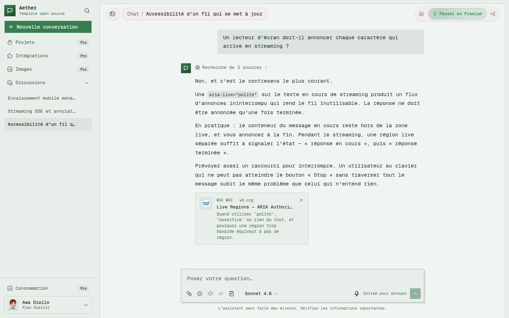
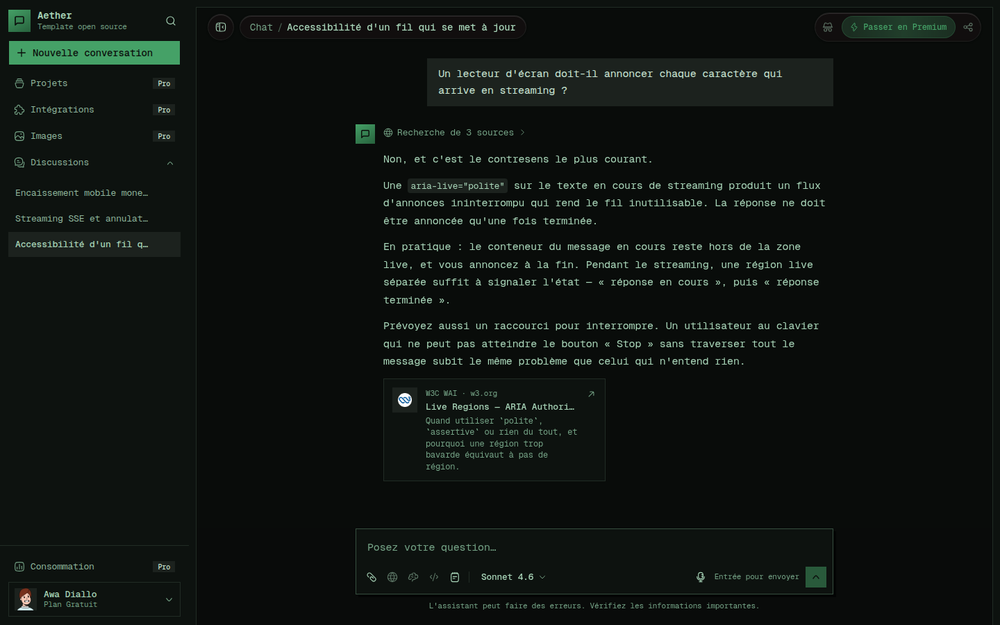
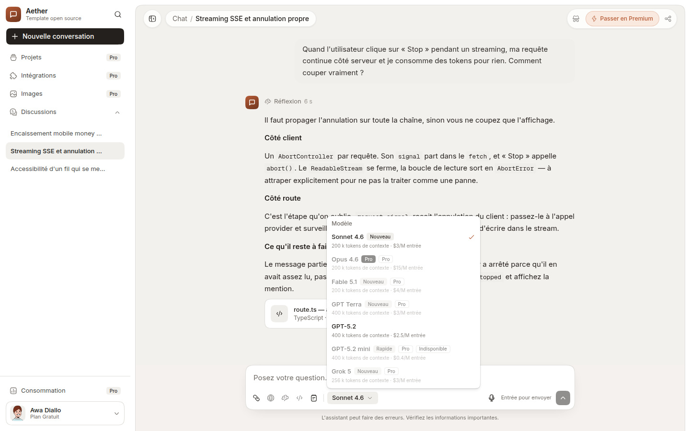
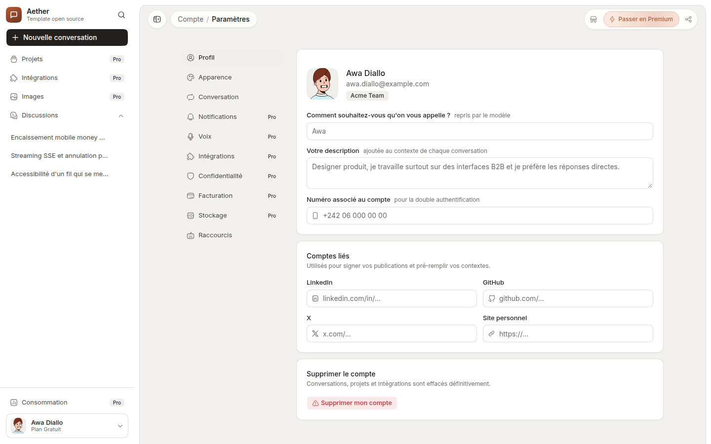

# Aether

**AI chat interface template, by UIForge**

A Next.js chat UI with real streaming, three themes and a provider layer you can point at any model. It runs out of the box on a mock provider, so you can see it work before you add an API key.

[](LICENSE)



## Screenshots

Three themes, each with a light and a dark mode. The user picks one in the settings and the choice is kept in `localStorage`.

| Theme | Light | Dark |
| --- | --- | --- |
| Minimal |  |  |
| Contrast |  |  |
| Terminal |  |  |





## Quick start

Requires Node.js 20.9 or later.

```bash
git clone https://github.com/UiForge-kit/uiforge-aether.git aether && cd aether
npm install
npm run dev
```

Open http://localhost:3000. No `.env` file is needed: without an API key the app uses a mock provider. Its answers are pre-written, but they travel through the same route, the same SSE protocol and the same cancellation path as a real model.

## Free and Pro

This repository is the Free version (MIT). The Pro modules are visible in the interface but locked: each one opens a "Disponible en Pro" card instead of the feature. The Free code contains only an entry-point stub for each of them, no hidden implementation.

| Module | Free | Pro |
| --- | :---: | :---: |
| Streaming chat, history, markdown, code blocks | Yes | Yes |
| Canvas (long documents next to the thread) | Yes | Yes |
| Conversation search, themes, settings (profile, appearance, conversation, shortcuts) | Yes | Yes |
| Projects | Locked | Yes |
| Integrations | Locked | Yes |
| Images | Locked | Yes |
| Voice | Locked | Yes |
| Usage | Locked | Yes |
| Share | Locked | Yes |
| Incognito conversation | Locked | Yes |
| Notifications, privacy, billing and storage settings | Locked | Yes |

The registry is `config/modules.ts`. Navigation, settings tabs, shortcuts and the sitemap read from it.

Free limits live in `config/limits.ts`:

| Limit | Free value |
| --- | --- |
| Attachments per message | 3 |
| Messages sent to the model as context | 10 (the client keeps the last 10, the server refuses more) |
| Conversations kept on the device | 30 (oldest unpinned ones are dropped) |
| Selectable models | `claude-sonnet-4-6`, `gpt-5.2` |
| Composer tools | `attachments`, `canvas` |

`POST /api/chat` enforces the model, tool, context and attachment limits on the server, so hiding a button in the UI is not the only protection.

The purchase link shown on locked cards is set with `NEXT_PUBLIC_UPGRADE_URL`. Leave it empty and the card is still shown, without a link.

## Features

- **Streaming chat**: message thread, markdown with GFM, collapsible reasoning steps, link previews, attachments, stop button that keeps the partial message.
- **Composer**: model selector, attachments (drag and paste included) and toggleable tools. A tool the current model cannot run is disabled automatically.
- **Syntax-highlighted code blocks** with `prism-react-renderer`, shared by the markdown renderer and the canvas. The colors come from CSS variables, so highlighting follows the active theme.
- **Canvas**: a long document (code or markdown) opens in its own window with tabs, copy and a download that uses the right file name.
- **Answer feedback**: like and dislike next to copy, share and retry. Votes are stored apart from the thread; `store/feedback-store.ts` is where you plug in real feedback collection.
- **Conversation search** in a modal (`⌘F`), with preview, date and group for each result.
- **Three themes**, each in light and dark: `minimal`, `contrast`, `terminal`.
- **Glass top bar**: translucent pills over the content with `backdrop-filter` (`.glass-pill` in `app/globals.css`), with an opaque fallback where blur is not supported.
- **Settings**: profile (nickname, description, generated avatars), appearance and font, conversation, keyboard shortcuts.
- **Language selector**: eight locales. The choice is stored but nothing is translated, because the template ships no i18n layer. The ids in `config/languages.ts` follow BCP 47 so plugging in your own is straightforward.
- **Keyboard shortcuts**: new conversation, stop generation, search, settings, sidebar, light/dark toggle. The list is in `config/shortcuts.ts`, and `⌘` becomes `Ctrl` outside macOS.
- **Local persistence**: conversations and preferences survive a reload, with no backend. A `ChatStorage` interface lets you swap `localStorage` for something else.
- **Responsive layout**: the sidebar becomes a drawer under 768 px.
- **SEO basics**: `robots.txt` and `sitemap.xml` routes, canonical URL and Open Graph metadata. Indexing is off by default.

## Tech stack

| | |
| --- | --- |
| Framework | Next.js 16.3 (App Router) |
| UI | React 19.2 |
| Language | TypeScript 5 (strict) |
| Styling | Tailwind CSS 4 |
| Components | shadcn/ui primitives on Base UI (`@base-ui/react`) |
| Icons | Hugeicons (free set) |
| Animation | Motion 13 |
| State | Zustand 5 |
| Markdown | react-markdown 10 + remark-gfm |
| Code highlighting | prism-react-renderer 2 |
| Avatars | DiceBear 9, generated locally |
| Charts | Chart.js 4 + react-chartjs-2 (installed, not used by the Free code) |
| Node.js | 20.9 or later |

## Project structure

```
app/
├─ (app)/          routes: chat, settings, one thin route per module
└─ api/            chat (SSE), conversations
components/
├─ chat/           thread, messages, markdown, reasoning, composer
├─ canvas/         card in the thread and full window
├─ code/           highlighted code block
├─ layout/         shell, mobile drawer
├─ pro/            "Disponible en Pro" cards
├─ search/         conversation search modal
├─ settings/       settings shell and sections
├─ sidebar/        grouped history, navigation, account
├─ topbar/         glass pills: model selector, upgrade link
└─ ui/             shadcn primitives (do not edit, style through tokens)
config/            site, models, themes, fonts, limits, api limits,
                   module registry, composer tools, shortcuts, languages
modules/           one folder per Pro module, each a stub entry point
lib/
├─ ai/             provider registry, SSE encoding, providers/
├─ api/            guard, rate limiter, body reader, validation, tests
├─ storage/        ChatStorage interface and localStorage adapter
└─ mock/           demo data and mock replies
store/             Zustand stores
types/             shared types (types/ai.ts holds the stream protocol)
docs/screenshots/  images used by this README
```

## Customize

### Brand and name

Edit `config/site.ts`: `name`, `shortName`, `tagline`, `description` and `repository`. The upgrade link comes from `NEXT_PUBLIC_UPGRADE_URL`, not from this file. `SITE_URL` reads `NEXT_PUBLIC_SITE_URL` and feeds the canonical URL, Open Graph tags and the sitemap. `STORAGE_NAMESPACE` prefixes the keys written to `localStorage`; change it so your app does not share keys with another Aether instance on the same origin.

The UI strings are in French. Edit them in place; there is no translation layer.

### Themes

A theme only redefines values, never names, so adding one touches no component.

1. In `app/globals.css`, copy a `[data-theme="..."]` block and its `.dark` variant, then change the values. The `--code-*` variables are part of it, so syntax highlighting follows.
2. Declare the theme in `config/themes.ts` so it shows up in the picker.
3. Add its chart palette in `config/chart-theme.ts`.
4. Extend the `ThemeId` type in `types/theme.ts`.

Components should name a role (`--brand`), never a raw color. The default theme is set by `DEFAULT_THEME_ID` in `config/themes.ts`.

### Avatars

`lib/avatars.ts` generates the profile avatars locally with DiceBear (three styles: Adventurer, Fun Emoji, Micah). No network request is made. If you remove a style, update the attribution section of `NOTICE` too.

### Fonts

`app/layout.tsx` loads Inter, Space Grotesk, Lora and Geist Mono through `next/font/google`. The picker options are declared in `config/fonts.ts`. To add a font, load it in the layout with a CSS variable, then add an entry to `FONT_OPTIONS`.

### Models

`config/models.ts` lists the models shown in the selector, with their real provider ids, context window and capabilities. The `allowedModelIds` in `config/limits.ts` decides which ones the server accepts. A model outside that list returns a 403 from `/api/chat`, whatever the provider.

## Connect a real model

Set the provider in `.env.local`:

```bash
AI_PROVIDER=anthropic
ANTHROPIC_API_KEY=your-key
```

For OpenAI, use `AI_PROVIDER=openai` and `OPENAI_API_KEY`. If `AI_PROVIDER` is not set, an Anthropic key selects Anthropic, otherwise an OpenAI key selects OpenAI, otherwise the mock runs. Restart the dev server after changing the file. Keys are read on the server only.

Both adapters use plain `fetch`, no provider SDK.

### The SSE protocol

`POST /api/chat` takes `{ messages, modelId, tools }` and answers with `text/event-stream`. Each frame is `data: <json>` followed by a blank line, and the JSON is one of six events (`types/ai.ts`):

```ts
type StreamEvent =
  | { type: "start"; messageId: string; modelId: string }
  | { type: "reasoning"; step: ReasoningStep }
  | { type: "delta"; text: string }
  | { type: "usage"; usage: TokenUsage }
  | { type: "done"; finishReason: FinishReason }
  | { type: "error"; code: string; message: string };
```

Encoding and decoding both live in `lib/ai/stream.ts`. The UI only knows these events, so changing provider never touches a component.

### Cancellation

The Stop button aborts the request. The route passes `request.signal` to the provider, and your provider must forward it to its upstream `fetch`. If it does not, the screen stops updating but the upstream call keeps running, and you keep paying for it.

### Add a provider

1. Create `lib/ai/providers/<name>.ts` exporting an `AIClient`: a `streamChat(request)` generator that yields `StreamEvent`s. `upstream-sse.ts` has helpers for reading an upstream SSE stream.
2. Add the id to `ProviderId` in `types/model.ts` and register the client in `REGISTRY` in `lib/ai/client.ts`.
3. Read its key from `process.env` on the server and document it in `.env.example`.
4. Select it with `AI_PROVIDER=<name>` and add its models to `config/models.ts` and, if needed, to `allowedModelIds` in `config/limits.ts`.

Do not change the SSE protocol while doing this: the client decodes it.

## Protect the API

Read this before going to production. As shipped, `/api/chat` is open and can spend your API credits.

- **Authentication.** `authorize(request)` in `lib/api/guard.ts` returns `null` by default, which allows everyone. Implement your session or API key check there and return a 401 or 403 `Response` to reject. Every route in `app/api/` goes through `guardRequest`.
- **Request size and shape.** `config/api.ts` caps the body at 256 KB, 100 messages per request, 32,000 characters per message, 10 attachments per message and 16 tools. The payload is validated before it reaches a provider.
- **Rate limit.** 20 requests per IP per 60 seconds on `/api/chat` (`API_RATE_LIMIT_MAX`, `API_RATE_LIMIT_WINDOW_SECONDS`), 120 per window on `/api/conversations`. The counters are in memory and per instance: they do nothing useful behind several replicas or on serverless. Replace them with a shared store such as Redis or a KV before you rely on them.
- **Client IP.** The limiter keys on `x-forwarded-for`, then `x-real-ip`. The first `x-forwarded-for` value can be forged unless your proxy overwrites the header. Check how your host sets it.
- **Plan limits.** Models, tools, context size and attachments are checked on the server in `lib/api/entitlements.ts`.
- **Secrets.** API keys stay in the server environment. Never prefix them with `NEXT_PUBLIC_`.

## Environment variables

Copy `.env.example` to `.env.local`.

| Variable | Default | Description |
| --- | --- | --- |
| `AI_PROVIDER` | `mock` | Active provider: `mock`, `anthropic` or `openai`. If unset, a present key selects its provider. |
| `ANTHROPIC_API_KEY` | empty | Anthropic API key. Server only. |
| `OPENAI_API_KEY` | empty | OpenAI API key. Server only. |
| `NEXT_PUBLIC_SITE_URL` | `http://localhost:3000` | Public URL of the deployment, used for canonical, Open Graph and sitemap. |
| `NEXT_PUBLIC_ALLOW_INDEXING` | `false` | Set to `true` to let search engines index the site. |
| `API_RATE_LIMIT_MAX` | `20` | Requests allowed per IP per window on `POST /api/chat`. |
| `API_RATE_LIMIT_WINDOW_SECONDS` | `60` | Length of the rate limit window, in seconds. |
| `NEXT_PUBLIC_UPGRADE_URL` | empty | Purchase page linked from locked modules. Empty means no link. |

## Scripts

| Command | What it does |
| --- | --- |
| `npm run dev` | Start the dev server |
| `npm run build` | Production build |
| `npm start` | Serve the production build |
| `npm run lint` | ESLint |
| `npm run typecheck` | `next typegen` then `tsc --noEmit` |
| `npm test` | Node test runner on `lib/**/*.test.ts` |

## Deploy

Aether is a standard Next.js app, so any host that runs Next.js works. On Vercel:

1. Push the repository to your Git provider and import it as a new project. The Next.js preset needs no extra setting.
2. Add the environment variables from the table above in the project settings. At least set `NEXT_PUBLIC_SITE_URL`, and your provider key if you want a real model.
3. Deploy.

The chat route sets `maxDuration = 300`; check what your plan allows for function duration. Read "Protect the API" first: the in-memory rate limiter does not span serverless instances, and `authorize()` is open until you implement it.

## FAQ

**Does it work without an API key?**
Yes. The mock provider streams pre-written answers through the real route and protocol. Only the content is simulated.

**Why does picking Opus or Grok return an error?**
The selector lists every model in `config/models.ts`, but the Free `allowedModelIds` only accepts `claude-sonnet-4-6` and `gpt-5.2`. The server refuses the others with a 403. Edit `config/limits.ts` if you want a different set.

**Where is the data stored?**
Conversations, preferences and feedback are kept in the browser's `localStorage`. There is no database. `GET /api/conversations` only returns seed data. To persist on a server, implement the `ChatStorage` interface in `lib/storage/adapter.ts` and switch the line in `lib/storage/index.ts`.

**Is the interface translated?**
No. The UI is in French and the language selector only stores a choice. See the Features section.

**Can I use it in a commercial project?**
Yes, the code is MIT. Keep the license and the third-party notices (see License).

**How do I unlock the Pro modules?**
They are not part of this repository. The locked cards link to `NEXT_PUBLIC_UPGRADE_URL`.

## License

MIT, see [LICENSE](LICENSE). Third-party material is listed in [NOTICE](NOTICE). The avatar gallery uses DiceBear styles whose artwork is licensed under CC BY 4.0, which requires attribution: keep the DiceBear section of `NOTICE` (or credit the authors in your own product) as long as you ship those avatars.

## Support

Found a bug or have a question? Open an issue on the repository. See [CONTRIBUTING.md](CONTRIBUTING.md) if you want to send a change.
